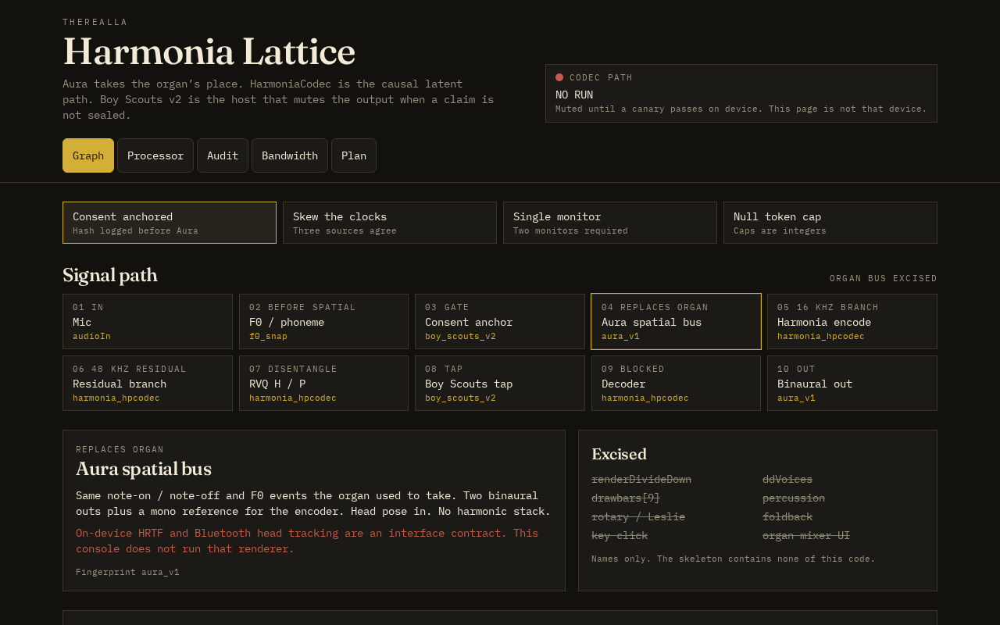
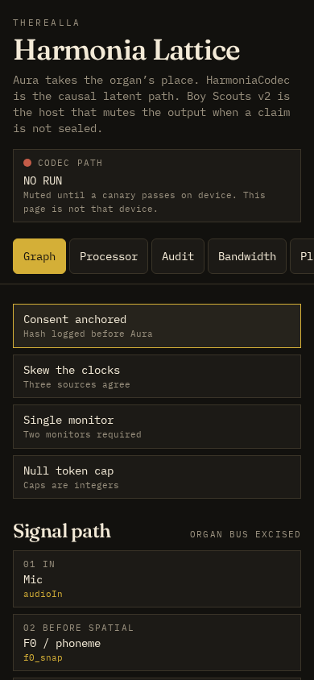

# HARMONIA LATTICE
### A research-oriented interactive instrument for causal audio systems, spatial synthesis, and evidence-governed signal processing

  

<em>Desktop interface · 1280 × 800 viewport · captured preview artifact</em>

---

## Abstract

**Harmonia Lattice** is an interactive audio-systems workspace organized around a central proposition: a sophisticated signal path should be inspectable as a system of explicit transformations, constraints, and evidence—not presented as an opaque collection of controls.

The project brings together a browser-delivered instrument interface, a declared processor contract, and a verification-oriented audit model. Its vocabulary includes **Aura** for spatial output, **HarmoniaCodec** for a proposed causal latent-codec path, **F0 Snap** for pitch quantization, and **Boy Scouts v2** for evidence and policy evaluation. The previous divide-down organ bus is explicitly designated as removed in the processor contract; it is not an alternate signal path to be reintroduced under a different control label.

The present repository is an engineering workbench and interface prototype. It is not represented as a validated production audio engine. That distinction is foundational: a visible interface, a passing static check, or a successful browser preview does not establish real-time safety, codec fidelity, perceptual quality, bounded latency, or target-hardware readiness.

## Design thesis

The system is framed as a lattice because its components are intended to be evaluated relationally. A processing stage is meaningful only in the context of its inputs, outputs, timing assumptions, invariants, and independent observations.

The architecture therefore emphasizes five principles:

1. **Causality before convenience.** The declared codec path requires causal processing; look-ahead is forbidden by the current processor contract.
2. **Fail-closed behavior.** Missing consent anchors, unverified decoder streaming, unmeasured bitrates, or failed policy checks must not be silently promoted into valid output.
3. **Evidence before assertion.** A claim is not a measurement. A self-check is not a hardware canary. A configuration value is not a benchmark result.
4. **Explicit subsystem boundaries.** Interface, application orchestration, processor specification, and audit logic are distinct concerns.
5. **Reproducibility.** Versioned schemas, fingerprints, frozen benchmark fields, and explicit failure reasons are used to make results comparable and discrepancies visible.

## System composition

| Subsystem | Responsibility | Current interpretation |
|---|---|---|
| **Lattice interface** | Interactive browser-facing instrument and system workspace | React-based application surface |
| **Aura (aura_v1)** | Spatial-output identity and binaural L/R plus mono-reference contract | Declared processor fingerprint; target-hardware validation remains outstanding |
| **HarmoniaCodec (harmonia_hpcodec)** | Causal latent-codec path | Decoder streaming is explicitly unverified; decode remains fail-closed |
| **F0 Snap (f0_snap)** | Pitch quantization before the spatial bus | Declared processing-stage contract |
| **Boy Scouts v2** | Audit host, invariants, canary families, evidence and policy decisions | Verification framework and configuration |
| **Application shell** | Routing, styles, preview integration and runtime configuration | TanStack Start / React / Vite toolchain |

### Signal-path contract

The processor source currently describes the intended sequence:

    input → F0 Snap → Aura spatialization → Harmonia encode
          → verified causal decode → Aura spatialization → output

This is a contract-level description, not evidence that every stage is operational. The source explicitly states that decoder streaming is not verified and that the decoder returns silence while verification is absent. The processor configuration also declares production_ready: false.

### Audit and policy model

The audit configuration records:

- Schema version and implementation fingerprints.
- A fail-closed consent gate requiring both a voice-model hash and an Aura profile identifier.
- A dual-monitor requirement for spatial-output authorization.
- Canary families and their expected verdicts.
- Frozen benchmark fields and schema-drift protection.
- Clock-discordance quarantine rather than retrospective timestamp invention.
- Explicit bitrate ceilings for the 16 kHz and 48 kHz branches, with the current grade marked **unverified**.
- Causal-processing requirements and a prohibition on look-ahead.

These declarations define what must be demonstrated. They do not certify that the demonstrations have already occurred.

## Interface previews

The repository includes the original captured desktop and mobile preview artifacts.

  

<em>Mobile interface · 390 × 844 viewport · captured preview artifact</em>

The associated machine-readable capture record is [screenshots/app-builder-preview.json](screenshots/app-builder-preview.json). It records the capture viewport dimensions, HTTP status, page title, canvas presence, text fingerprint, overflow check, and browser error observations. Its reported zero console and page errors apply to that recorded preview session only; they are not a general runtime guarantee.

## Repository map

    .
    ├── .grok/                 # Workspace and platform-specific configuration
    ├── .github/workflows/     # Repository automation
    ├── attachments/           # Project-associated attachments
    ├── migrations/             # Database migration assets
    ├── public/                 # Public static assets
    ├── screenshots/            # Desktop/mobile captures and capture metadata
    ├── scripts/                # Build, policy, brand and verification utilities
    ├── server/                 # Application server integration
    ├── src/
    │   ├── components/         # Lattice interface and preview bridge
    │   ├── lib/                # Shared application, auth, data and audit logic
    │   ├── routes/             # TanStack Router route definitions
    │   └── spec/               # Processor and audit configuration contracts
    ├── startup.sh              # Workspace startup entry point
    ├── package.json            # Scripts and dependency manifest
    ├── package-lock.json       # Locked dependency graph
    ├── tsconfig.json           # TypeScript compiler configuration
    └── vite.config.ts          # Vite / TanStack build configuration

## Development environment

### Requirements

- Node.js compatible with the repository's configured toolchain (the workspace contract specifies Node 22).
- npm.
- A POSIX-compatible shell for the supplied startup script.

### Install and run

    npm install
    npm run dev

The development script invokes the repository's environment wrapper and starts Vite on port **8080**. The supplied startup.sh is the workspace revive entry point and is designed for the original hosted preview environment; it assumes the project root is /workspace.

### Verification commands

    npm run typecheck
    npm run check:auth
    npm test
    npm run lint
    npm run build

The build command also invokes the database migration script. Review the deployment environment and migration configuration before running it against any persistent database. No claim is made here that these commands have been executed successfully after the archive import.

## Runtime and data posture

The checked-in application environment configuration sets:

- VITE_AUTH_ENABLED: false
- Database deployment: false

The codebase contains pre-wired authentication and database support, but their presence is not proof that either feature is enabled in a deployment. Environment variables, platform configuration, and deployment-time behavior must be reviewed independently. Never commit credentials, private keys, API tokens, or production database connection strings.

The application shell also includes platform preview integration. The preview bridge and PWA integration are part of the original workspace contract; changes to them should be made only with an understanding of the hosting platform's requirements.

## Verification status and limitations

| Proposition | Status in the checked-in contract |
|---|---|
| Browser preview capture exists for desktop and mobile | **Recorded** |
| Preview capture reported HTTP 200 and no browser console/page errors | **Recorded for that capture only** |
| Processor fingerprints are declared | **Yes** |
| Consent gate is specified as fail-closed | **Yes** |
| Causal decoder streaming is verified | **No** |
| Target-hardware canary has passed | **No** |
| 16 kHz / 48 kHz bitrate ceilings have been measured and met | **No; grade is unverified** |
| Production readiness | **Explicitly false** |

A production-readiness claim requires, at minimum, independently reproducible target-hardware canaries, verified causal streaming behavior, measured bitrate and latency distributions, failure-path testing, numerical stability analysis, and a documented review of the complete deployed signal path. The present repository must not be cited as satisfying those requirements until corresponding evidence is committed and reviewed.

## Engineering method

Contributions should preserve the separation between declared intent and observed behavior.

- Change processor contracts and audit configuration together when semantics change.
- Treat fingerprints and schema versions as compatibility boundaries.
- Do not weaken fail-closed conditions to make a demo appear operational.
- Do not convert absent measurements into zero-valued success.
- Preserve the benchmark schema or introduce an explicit migration.
- Record the exact test command, environment, commit, and result for every verification claim.
- Keep screenshots labeled as captures, not as proof of acoustic or DSP correctness.

## License

See [LICENSE](LICENSE).

---

*Harmonia Lattice — a systems-oriented instrument prototype whose governing rule is simple: the sophistication of a claim must never exceed the strength of its evidence.*
